<h1 align="center">Hi 👋, I'm Dias Serikkhanov</h1>
<h3 align="center">Software Engineer from Kazakhstan</h3>

  

- 💼 Building web platforms, APIs and mobile apps — end to end
- 📱 Expanding into mobile development with Flutter
- 🤖 Using AI tools every day — and verifying with tests
- 🎓 BSc in Cybersecurity · MSc in IT Management
- 📫 How to reach me: **[smkndnn@gmail.com](mailto:smkndnn@gmail.com)**

### Connect with me:

  
  

### Languages and Tools:

  

 
